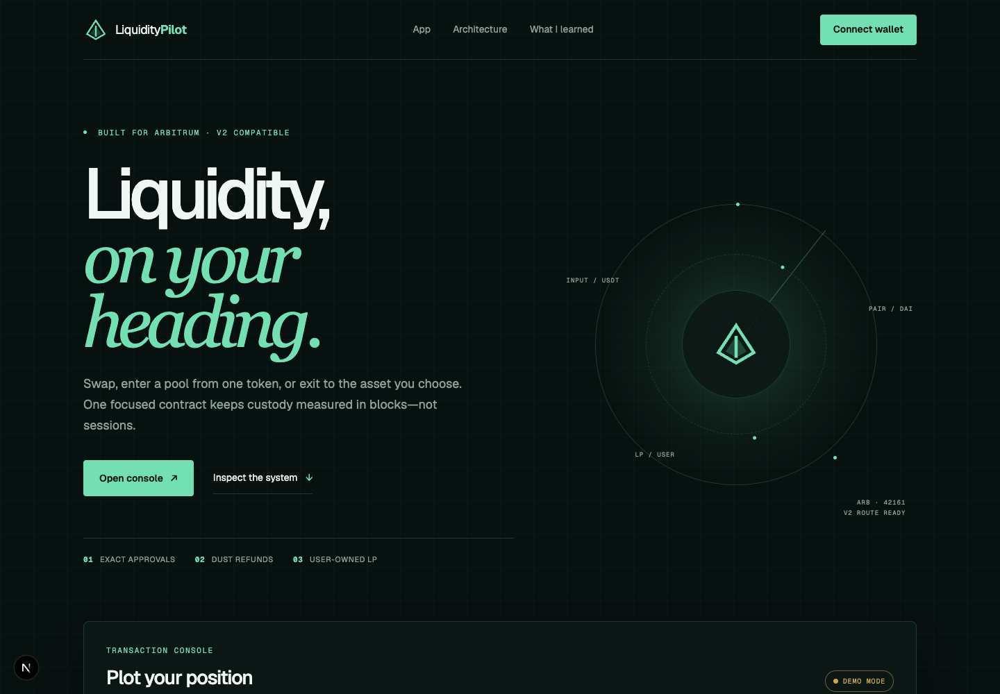
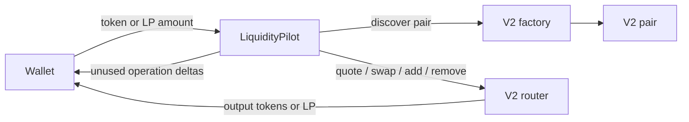

# LiquidityPilot

[](https://github.com/alsaecas/liquidity-pilot/actions/workflows/contracts.yml)
[](https://github.com/alsaecas/liquidity-pilot/actions/workflows/frontend.yml)
[](LICENSE)

**Non-custodial token swaps and one-click Uniswap V2 liquidity management on Arbitrum.**
LiquidityPilot lets a wallet swap ERC-20s, enter a direct V2 pool from one token, remove a
position into both assets, or exit into one selected token. The Solidity contract is generic;
the interface highlights Arbitrum's USDT/DAI pair.



> Status: portfolio/educational software. No Arbitrum mainnet deployment is claimed. The
> frontend runs in clearly labelled demo mode until a contract address is configured.

## Features

- Configurable exact-input ERC-20 paths, including multi-hop swaps
- One-sided pool entry with one input transfer, direct-to-user LP minting, and dust refunds
- Correct LP custody and exact approval before liquidity removal
- Optional single-token exit that combines both removed assets
- Deadlines, minimum outputs, exact USDT-compatible approvals, custom errors, and reentrancy guard
- Deterministic Foundry unit/fuzz tests plus optional real Arbitrum fork integration
- Responsive Next.js console with wallet connection, network guard, mode-specific previews,
  approval/execution stages, risk messaging, and explicit demo state

## What this project demonstrates

LiquidityPilot turns the mechanics studied in Blockchain Accelerator Module 11 into an original
end-to-end product: contract API design, V2 coordination, LP-token lifecycle management,
non-custodial settlement, deterministic mocks, fork validation, typed frontend configuration,
CI, deployment scripts, and security documentation.

## Module 11 concepts applied

| Concept | Application here |
| --- | --- |
| Router interaction | Quotes, configurable swaps, liquidity addition and removal |
| Factory discovery | Every liquidity flow resolves the pair through `getPair` |
| Safe token handling | `SafeERC20`, exact `forceApprove`, and allowance reset |
| LP management | LP tokens mint to the recipient and are pulled before removal |
| Fork testing | Real Arbitrum bytecode, pair composition, quote, swap, add, and remove |

The full evidence map is in [docs/learning-notes.md](docs/learning-notes.md).

## From reference concept to original implementation

This repository was designed independently after studying the course example. Its broader API
supports arbitrary compatible pairs, a configurable path, single-token exit, balance-delta
refund accounting, immutable configuration, exact approvals, deterministic mocks, and a
purpose-built interface. In particular, one-sided entry pulls the full input once and the
removal flow first transfers LP tokens into the contract that approves the router.

## Architecture



See [docs/architecture.md](docs/architecture.md) for trust boundaries and sequence details.

## Contract flows

### Swap

`swapExactTokens` validates the deadline, recipient, amount, and every path address before
pulling the input. It approves exactly `amountIn`, routes the output directly to the selected
recipient, clears the allowance, returns the router's actual output, and emits a reconciliation
event.

### One-sided entry

`zapIn` verifies a direct pair, pulls the full input once, swaps approximately half for the
paired asset, and supplies the two operation-specific balance deltas. LP tokens mint directly
to the recipient. Unused deltas return to the caller, without exposing unrelated accidental
balances.

### Standard removal

`removeLiquidity` resolves the LP token through the factory, pulls the exact LP amount from the
caller, approves the router, removes directly to the recipient, then clears the approval.

### Single-token exit

`zapOutToSingleToken` removes both assets into LiquidityPilot, retains the selected asset, swaps
the other asset along a direct path, combines the output, transfers it, and refunds any
operation-related remainder.

## Repository structure

```text
src/                  Main contract and minimal V2 interfaces
test/unit/            Deterministic unit and fuzz tests
test/fork/            Optional Arbitrum fork tests
test/mocks/           Original ERC-20, factory, pair and router mocks
script/               Local and Arbitrum deployment scripts
frontend/             Next.js App Router interface
docs/                 Architecture, security, learning notes and screenshot
.github/workflows/    Contract, frontend and manual fork CI
```

## Requirements and setup

- Foundry stable
- Node.js 22 (minimum 20.9)
- Corepack/pnpm 10.28

```bash
git clone https://github.com/alsaecas/liquidity-pilot.git
cd liquidity-pilot
cp .env.example .env
make install
make check
```

Dependencies are pinned through Foundry references and `frontend/pnpm-lock.yaml`.

## Unit tests

The normal suite is deterministic and does not need an RPC endpoint:

```bash
make test
make coverage
```

Core flow tests assert user, recipient, router, contract, and LP balances before and after the
operation. Fuzz properties cover input/refund accounting and exact minimum-output boundaries.

## Arbitrum fork tests

Add an archive-capable endpoint without committing it:

```bash
export ARBITRUM_RPC_URL="https://your-provider.example"
make test-fork
```

The tests first confirm bytecode at the router and factory, resolve the pair, and verify
`token0`/`token1`. Foundry `deal` funds a fresh test account; no whale account is impersonated.
Fork deadlines use `block.timestamp + 20 minutes`.

Verified integration constants:

| Component | Address |
| --- | --- |
| V2-compatible router | `0x4752ba5DBc23f44D87826276BF6Fd6b1C372aD24` |
| Factory | `0xf1D7CC64Fb4452F05c498126312eBE29f30Fbcf9` |
| USDT | `0xFd086bC7CD5C481DCC9C85ebE478A1C0b69FCbb9` |
| DAI | `0xDA10009cBd5D07dd0CeCc66161FC93D7c9000da1` |

## Local Anvil fork demo

In terminal one:

```bash
export ARBITRUM_RPC_URL="https://your-provider.example"
make local-anvil
```

In terminal two:

```bash
make deploy-local
```

Copy the printed LiquidityPilot address to `frontend/.env.local`, point
`NEXT_PUBLIC_LOCAL_RPC_URL` at Anvil, and start the frontend. `DeployLocal` deploys deterministic
mocks for offline development; use `DeployArbitrum` only with explicit deployment configuration.

## Frontend configuration

```bash
cd frontend
corepack pnpm install --frozen-lockfile
corepack pnpm dev
```

Supported environment variables:

```dotenv
NEXT_PUBLIC_LIQUIDITY_PILOT_ADDRESS=
NEXT_PUBLIC_ARBITRUM_RPC_URL=
NEXT_PUBLIC_LOCAL_RPC_URL=http://127.0.0.1:8545
NEXT_PUBLIC_SITE_URL=http://localhost:3000
```

If the contract address is blank, the site announces **Demo mode**, uses labelled sample
estimates, and disables transaction submission. It never reports a fake success.

## Deployment and verification

No mainnet deployment runs automatically. To deploy only after reviewing the environment:

```bash
export PRIVATE_KEY="..."          # use a dedicated safe deployer
forge script script/DeployArbitrum.s.sol:DeployArbitrum \
  --rpc-url "$ARBITRUM_RPC_URL" --broadcast
```

Verify using the constructor arguments (router, factory are embedded by the script):

```bash
forge verify-contract <DEPLOYED_ADDRESS> src/LiquidityPilot.sol:LiquidityPilot \
  --chain arbitrum --etherscan-api-key "$ARBISCAN_API_KEY"
```

Private keys, RPC credentials, broadcast files, `.env`, build output, and dependencies are
ignored. Never paste a seed phrase into project configuration.

## Security considerations

- This project is **not audited** and is not presented as production-ready.
- Fee-on-transfer and rebasing tokens are not supported.
- Router/factory correctness and ordinary ERC-20 behavior are trust assumptions.
- Minimum outputs and deadlines reduce, but do not eliminate, MEV and adverse movement.
- The 50/50 zap split is educational and is not reserve-optimized.
- There is no owner, privileged withdrawal, upgradeability, fee, or governance surface.

Read the complete [security notes](docs/security.md).

## Known limitations

- Direct pairs only for zap entry/exit; configurable multi-hop paths are exposed for swaps.
- No Permit2 or signature-based approval.
- Demo estimates are illustrative unless a contract deployment and live reads are configured.
- Public-chain deployment and professional audit are outside the current project scope.

## Roadmap

- Reserve-aware optimal one-sided swap sizing
- Permit2 support
- Live pool reserve and LP valuation preview
- Broader multi-pool token registry
- Independent security review before any real-funds recommendation

## Commands

| Command | Purpose |
| --- | --- |
| `make install` | Install Foundry and frontend dependencies |
| `make build` | Compile Solidity |
| `make test` | Run deterministic contract tests |
| `make test-fork` | Run optional Arbitrum integration |
| `make coverage` | Print unit-test coverage |
| `make frontend-dev` | Start the interface |
| `make frontend-build` | Create the production frontend build |
| `make check` | Run formatting, build, all unit/frontend checks |

## License and attribution

[MIT](LICENSE)

Built as an original project after studying DEX swaps and V2 liquidity management in
Blockchain Accelerator Module 11. This project is independent and does not imply endorsement
by the course creators.
