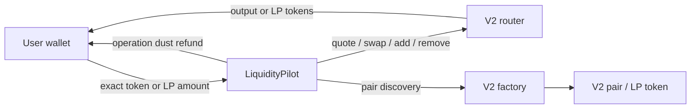
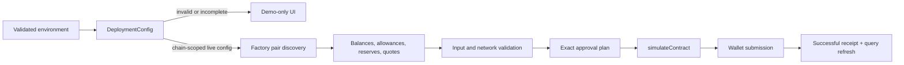

# LiquidityPilot architecture

LiquidityPilot is deliberately small: one immutable coordination contract, minimal V2
interfaces, and no owner, fee collector, proxy, or persistent position ledger.

## Contract boundaries

- The router and factory are immutable constructor configuration.
- Tokens are pulled only after path, pair, recipient, amount, and deadline validation.
- Router allowances are set to the exact operation amount with `forceApprove` and reset.
- LP tokens for removal are first transferred to LiquidityPilot; approval alone cannot
  give the router custody of tokens held by the user.
- `zapIn` measures balances before the operation and refunds only its own deltas. This
  prevents one user from receiving an unrelated balance accidentally sent to the contract.
- `zapOutToSingleToken` removes into the contract, swaps the non-selected asset, combines
  both output portions, transfers the result, and clears operation-related dust.

## Flows

### Swap

`validate → pull input → exact approval → router swap to recipient → clear approval → event`

### One-sided entry

`validate pair → pull once → swap ~half → add both deltas → mint LP to recipient → refund dust`

The half split is predictable and educational. A production optimizer could derive a
reserve-aware optimal swap amount, but that complexity is intentionally outside this scope.

### Standard removal

`resolve pair → pull LP → exact LP approval → remove directly to recipient → clear approval`

### Single-token exit

`resolve pair → pull LP → remove to pilot → swap other token → combine → transfer recipient`

## Frontend boundary

The Next.js application defaults to explicit demo mode when
`NEXT_PUBLIC_LIQUIDITY_PILOT_ADDRESS` is absent. Demo estimates are illustrative and its
transaction action is disabled; it does not manufacture transaction hashes or success states.
# Frontend live-data boundary

The interface has two intentionally separate states. `DeploymentConfig` validates all public
addresses and binds them to either Arbitrum One (`42161`) or local Anvil (`31337`). An incomplete
configuration is not partially trusted: it becomes demo mode, where submission is structurally
disabled and every estimate is labelled sample data.

Configured mode reads the factory pair first, rejects the zero address, then reads `token0`,
`token1`, reserves, total supply, LP decimals, the connected wallet's LP balance, USDT/DAI
balances, and user-to-Pilot allowances. Swap and zap-in quotes are debounced. Removal previews use
`reserve × selected LP / totalSupply`; a single-token exit additionally quotes the USDT portion
to DAI. React Query keys naturally refetch on account and chain changes, and every confirmed
receipt explicitly refreshes balances, allowances, pair state, quotes, and gas balance.

The execution state is explicit: quote preparation, approval required, allowance reset,
approval, approval confirmation, simulation, wallet confirmation, execution confirmation,
confirmed, failed, or rejected. A reverted receipt is never shown as success.
