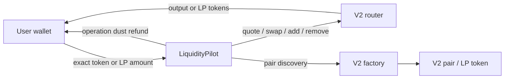

# LiquidityPilot architecture

LiquidityPilot is deliberately small: one immutable coordination contract, minimal V2
interfaces, and no owner, fee collector, proxy, or persistent position ledger.

## Contract boundaries

- The router and factory are immutable constructor configuration.
- Tokens are pulled only after path, pair, recipient, amount, and deadline validation.
- Router allowances are set to the exact operation amount with `forceApprove` and reset.
- LP tokens for removal are first transferred to LiquidityPilot; approval alone cannot
  give the router custody of tokens held by the user.
- `zapIn` measures balances before the operation and refunds only its own deltas. This
  prevents one user from receiving an unrelated balance accidentally sent to the contract.
- `zapOutToSingleToken` removes into the contract, swaps the non-selected asset, combines
  both output portions, transfers the result, and clears operation-related dust.

## Flows

### Swap

`validate → pull input → exact approval → router swap to recipient → clear approval → event`

### One-sided entry

`validate pair → pull once → swap ~half → add both deltas → mint LP to recipient → refund dust`

The half split is predictable and educational. A production optimizer could derive a
reserve-aware optimal swap amount, but that complexity is intentionally outside this scope.

### Standard removal

`resolve pair → pull LP → exact LP approval → remove directly to recipient → clear approval`

### Single-token exit

`resolve pair → pull LP → remove to pilot → swap other token → combine → transfer recipient`

## Frontend boundary

The Next.js application defaults to explicit demo mode when
`NEXT_PUBLIC_LIQUIDITY_PILOT_ADDRESS` is absent. Demo estimates are illustrative and its
transaction action is disabled; it does not manufacture transaction hashes or success states.
